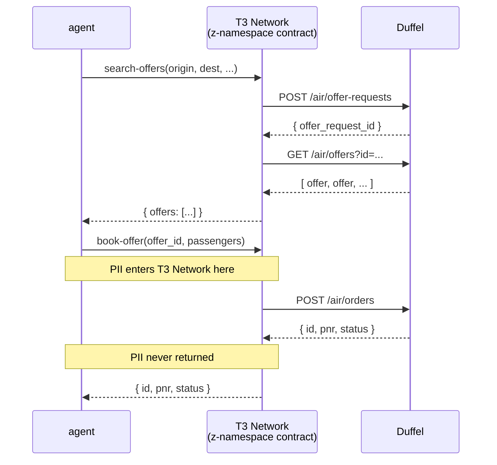

# z-tenant-flight

PII-safe Duffel flight-booking contract for Terminal 3 Network z-namespace
tenants — v0.4.1.

A Rust WASM contract that runs inside the Trinity TEE (Trusted Execution Environment) and calls the [Duffel](https://duffel.com) API synchronously via `host:interfaces/http`.

## What this is

Two contract functions exposed over WIT:

| Function | What it does |
|---|---|
| `search-offers` | POST to Duffel `/air/offer-requests`, then GET `/air/offers` — returns a list of available flights |
| `book-offer` | POST to Duffel `/air/orders` without exposing passenger PII to the contract caller — returns the booking ID and PNR |

Privacy guarantee: the `book-offer` input never accepts passenger PII. The
contract places profile placeholders in the Duffel payload, and the T3N host
resolves the approved user-profile values at dispatch time. Plaintext profile
data therefore never enters the WASM contract or crosses the WIT boundary.
Only the booking ID, PNR, and status return to the caller. Upstream error
bodies remain in enclave logs and are never returned to the caller.

## Host-capability manifest

Declare in your contract manifest:

```json
{
  "host_capabilities": [
    "kv_store",
    "logging",
    "tenant_context",
    "http",
    "http_with_placeholders"
  ]
}
```

The `http` capability enables outbound HTTP via the `tenant-http` linker world.

## Setup: providing the Duffel API key

Before deploying or calling this contract for the first time, the tenant SDK must:

1. Create the `secrets` KV map in the z: namespace.
2. Write the Duffel API key under the key `duffel_api_key`.

```bash
# Example via the tenant SDK / admin tooling:
z_sdk.kv("secrets").set("duffel_api_key", "<your Duffel test API token>")
```

The contract reads this value at runtime using `host:interfaces/kv-store` — no `secret` interface is involved. The `secrets` map is owned and populated externally by the tenant operator; the contract never writes to it.

## Building

```bash
rustup target add wasm32-wasip2
cargo build --target wasm32-wasip2 --release
```

The WASM artefact will be at `target/wasm32-wasip2/release/z_tenant_flight.wasm`.

## Running tests (native)

```bash
cargo test --lib
cargo clippy --all-targets -- -D warnings
```

## Contract functions

### `search-offers`

```wit
search-offers: func(req: search-offers-req) -> result<search-offers-resp, string>;
```

Input:

```json
{
  "origin": "LHR",
  "destination": "JFK",
  "departure_date": "2026-07-15",
  "cabin_class": "economy",
  "adult_count": 1
}
```

Returns a list of `offer` records, each with `id`, `total_amount`, `total_currency`, and `expires_at`.

### `book-offer`

```wit
book-offer: func(req: book-offer-req) -> result<booking, string>;
```

Input:

```json
{
  "offer_id": "off_abc123",
  "passenger_id": "pas_abc123",
  "total_amount": "199.00",
  "total_currency": "GBP"
}
```

`passenger_id` is an opaque Duffel passenger identifier returned by
`search-offers`; it is not PII. Passenger details are resolved by the host
from the caller's approved profile. Returns
`{ "id": "ord_...", "pnr": "ABC123", "status": "confirmed" }`.

## Operator handover

1. Compile the contract with the release command above and register the
   resulting WASM with the tenant's manifest.
2. Allow outbound access to `api.duffel.com` and grant the host capabilities
   listed above.
3. Create the tenant-owned `secrets` KV map and set `duffel_api_key` there.
   Never commit the key or place it in contract input.
4. Configure the caller-profile fields used by booking: `first_name`,
   `last_name`, `date_of_birth`, `gender`, and verified email. A booking fails
   closed if a required profile value is unavailable.
5. Run the native test and lint commands before each release, then deploy the
   explicit `wasm32-wasip2` release artefact.

## Architecture



